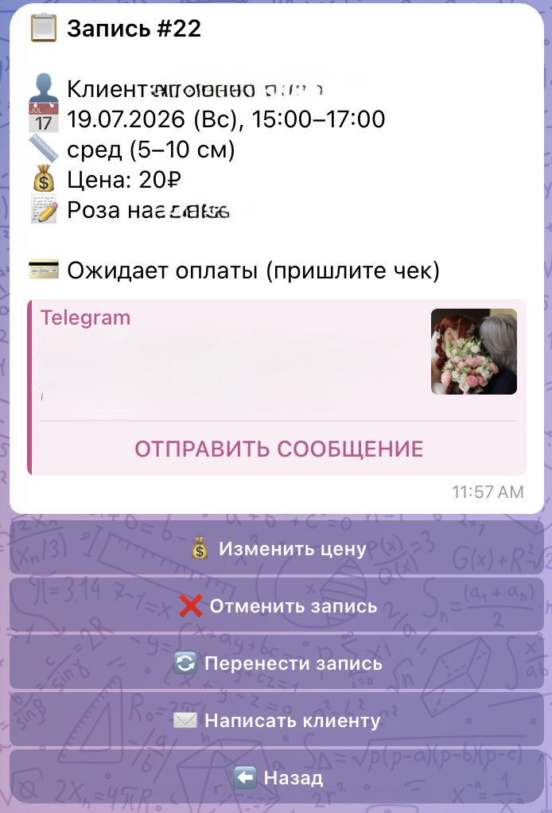
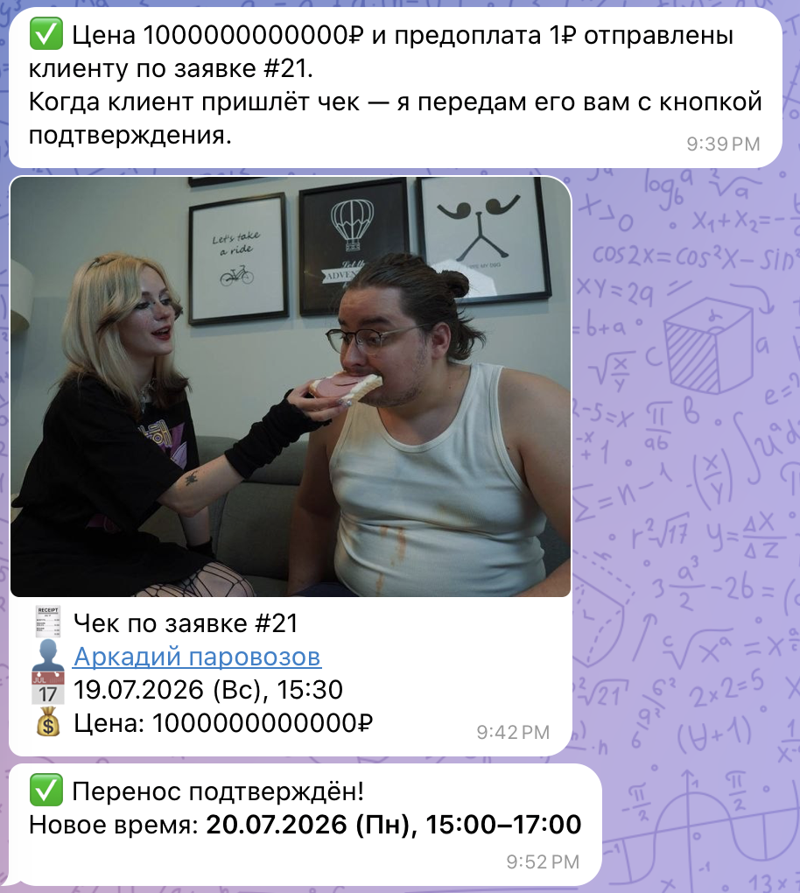
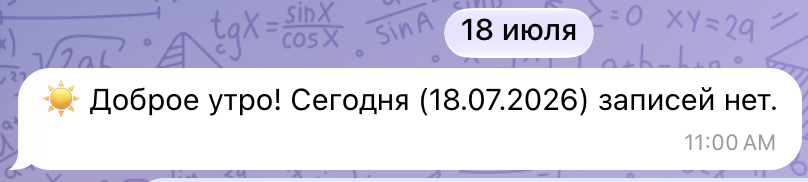

# 🃏 Arlekino — Telegram-бот для тату-студии

> ⚠️ **Статус: бот сейчас отключён от сервера** и временно не отвечает.
> Эта страница — витрина проекта.

👉 Бот: [@arlekino_tattoo_bot](https://t.me/arlekino_tattoo_bot)

Бот для записи клиентов в тату-студию: клиент сам выбирает мастера, размер работы,
день и время, а мастера и админ управляют расписанием прямо в Telegram.

## Как это выглядит

<table>
  <tr>
    <td align="center" width="50%"> Новая заявка у мастера и ввод итоговой цены</td>
    <td align="center" width="50%"> Карточка записи: изменить цену, отменить, перенести, написать клиенту</td>
  </tr>
  <tr>
    <td align="center"> Управление расписанием: рабочие дни ✓ и выходные студии ✖</td>
    <td align="center"> Цена и предоплата клиенту, чек оплаты, подтверждение переноса</td>
  </tr>
  <tr>
    <td align="center" colspan="2"> Утренняя сводка мастеру в 8:00</td>
  </tr>
</table>

## Возможности

### Клиент
- Регистрация и запись: мастер → размер → день → время → описание + фото эскиза
- Свободные окна считаются автоматически по расписанию мастера
- Мои записи, отмена и перенос с подтверждением
- Реквизиты для предоплаты и отправка чека
- Напоминания: за 3 дня, за 1 день и в день записи
- Отзывы о мастере

### Мастер
- Рабочие дни и время (`/schedule`), тиры размеров и цен (`/sizes`)
- Календарь записей (`/calendar`), реквизиты (`/myinfo`)
- Карточки заявок: подтверждение, правка итоговой цены, подтверждение оплаты
- Ежедневная сводка расписания в 8:00
- Месячная статистика

### Админ
- Добавление и удаление мастеров, закрытые дни студии

## Технологии

Python 3.11 · aiogram 3 · SQLite (aiosqlite) · APScheduler · long polling

## Исходный код

Репозиторий-витрина: код бота здесь не публикуется.
