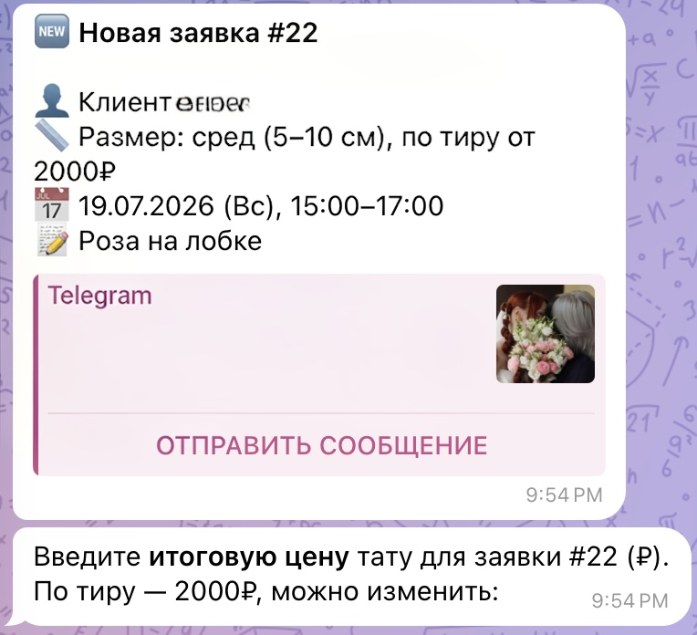
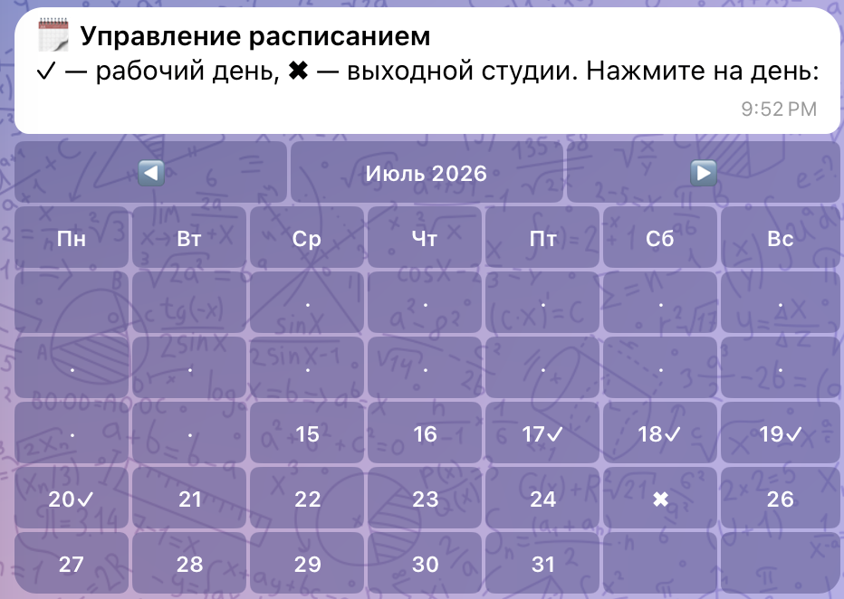
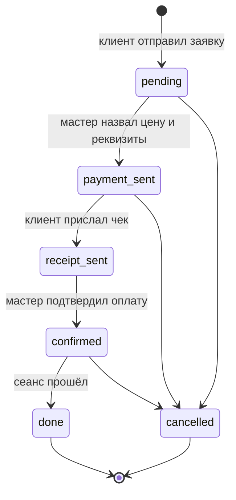

# 🃏 Arlekino — Telegram-бот для тату-студии


Клиент сам записывается на сеанс: выбирает мастера, размер работы, день и время, описывает идею и прикладывает эскиз. Мастер подтверждает заявку, называет цену и реквизиты, а бот ведёт запись до оплаты и напоминает обо всём вовремя.

> ⚠️ Сейчас бот **отключён от сервера** и не отвечает. Бот: [@arlekino_tattoo_bot](https://t.me/arlekino_tattoo_bot)
>
> Это витрина проекта. Исходный код хранится в приватном репозитории.

## Как это выглядит

<table>
  <tr>
    <td align="center" width="50%"><br><sub>Новая заявка у мастера и ввод итоговой цены</sub></td>
    <td align="center" width="50%"><br><sub>Карточка записи: изменить цену, отменить, перенести, написать клиенту</sub></td>
  </tr>
  <tr>
    <td align="center"><br><sub>Управление расписанием: рабочие дни ✓ и выходные студии ✖</sub></td>
    <td align="center"><br><sub>Цена и предоплата клиенту, чек оплаты, подтверждение переноса</sub></td>
  </tr>
  <tr>
    <td align="center" colspan="2"><br><sub>Утренняя сводка мастеру в 8:00</sub></td>
  </tr>
</table>

---

## Что умеет

- 📝 **Запись за пару нажатий**: мастер → размер → день → время → описание + фото. Свободные окна считаются по расписанию мастера.
- 💳 **Предоплата без переписки**: мастер присылает цену и реквизиты, клиент отправляет чек, мастер подтверждает оплату одной кнопкой.
- 🔄 **Перенос и отмена** записи с подтверждением.
- ⏰ **Напоминания**: клиенту за 3 дня, за 1 день и в день записи, мастеру — расписание на день.
- 📅 **Календарь мастера**: рабочие дни, блокировка времени, закрытые дни студии.
- ⭐ **Отзывы** о мастерах и месячная статистика.
- 🧹 **Автоочистка** старых записей с предупреждением админам за неделю.

## Роли

| Роль | Кто | Что доступно |
|---|---|---|
| **Админ** | `tg_id` из `PROG_ID` | `/admin`: мастера, закрытые дни студии. Может смотреть бота глазами мастера или клиента |
| **Мастер** | добавлен админом | `/schedule`, `/sizes`, `/calendar`, `/myinfo`, карточки заявок |
| **Клиент** | все остальные | `/start` → регистрация → запись, «мои записи» |

## Путь записи



## Напоминания и обслуживание

| Когда | Кому | Что |
|---|---|---|
| 8:00 | мастер | расписание на день |
| 10:00 | клиент | за 3 дня и за 1 день до записи |
| 9:00 | клиент | в день записи |
| 10:05 | админ | за 7 дней до конца месяца: что будет удалено |
| последний день месяца, 23:30 | — | удаление записей старше 3 месяцев |

Время системное, как на сервере с ботом.

## Структура проекта

```
bot/
  main.py             # запуск: база, диспетчер, планировщик, поллинг
  config.py           # токен и админы из окружения
  handlers/
    common.py         # /start, регистрация, общие хелперы
    client.py         # запись, мои записи, перенос, отмена, чек, отзывы
    master.py         # заявки, /schedule /sizes /calendar /myinfo
    admin.py          # мастера, закрытые дни студии
    prog.py           # режим «посмотреть глазами роли»
  keyboards/          # inline-клавиатуры по ролям + универсальный календарь
  db/
    models.py         # dataclass-модели и статусы записи
    queries.py        # SQLite (aiosqlite), схема создаётся автоматически
  services/
    slots.py          # вычисление свободных окон
    scheduler.py      # напоминания и ночная чистка
    views.py          # общие тексты и карточки
amvera.yml            # конфигурация деплоя
requirements.txt
```

Таблицы SQLite: `masters`, `clients`, `size_tiers`, `schedules`, `blocked_slots`, `appointments`, `payments`, `closed_days`, `reviews`.

## Стек

Python 3.11+ · aiogram 3 (long polling) · SQLite через aiosqlite · APScheduler · python-dotenv

## Исходный код

Код закрыт. Если хотите посмотреть его или обсудить проект, напишите мне через профиль на GitHub.
